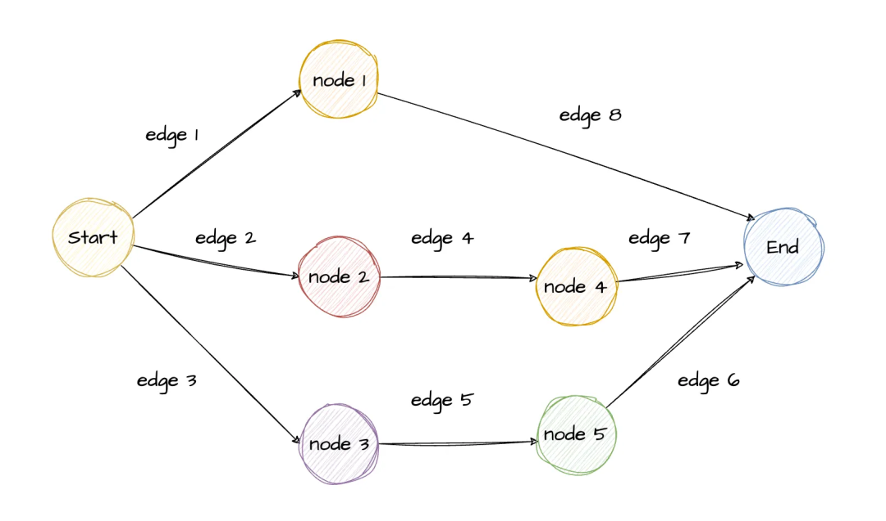
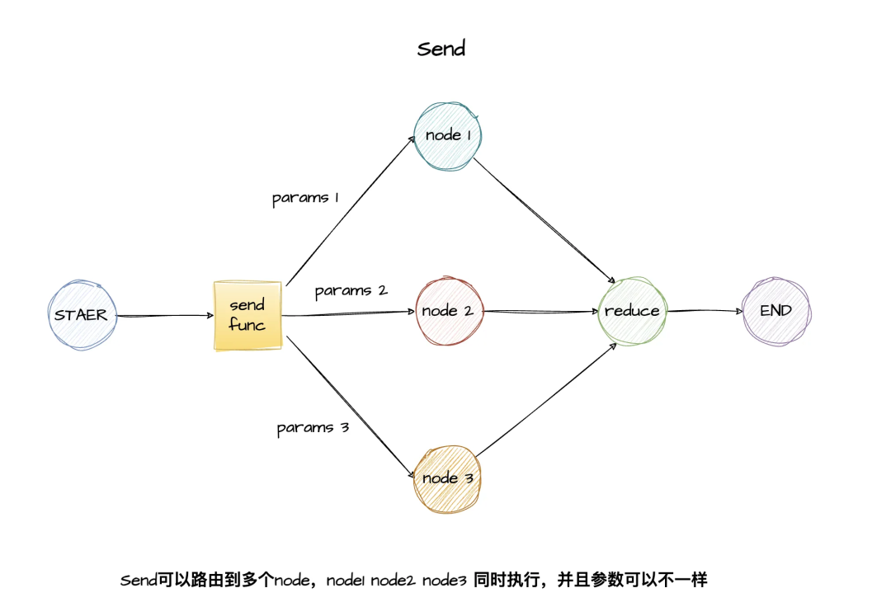
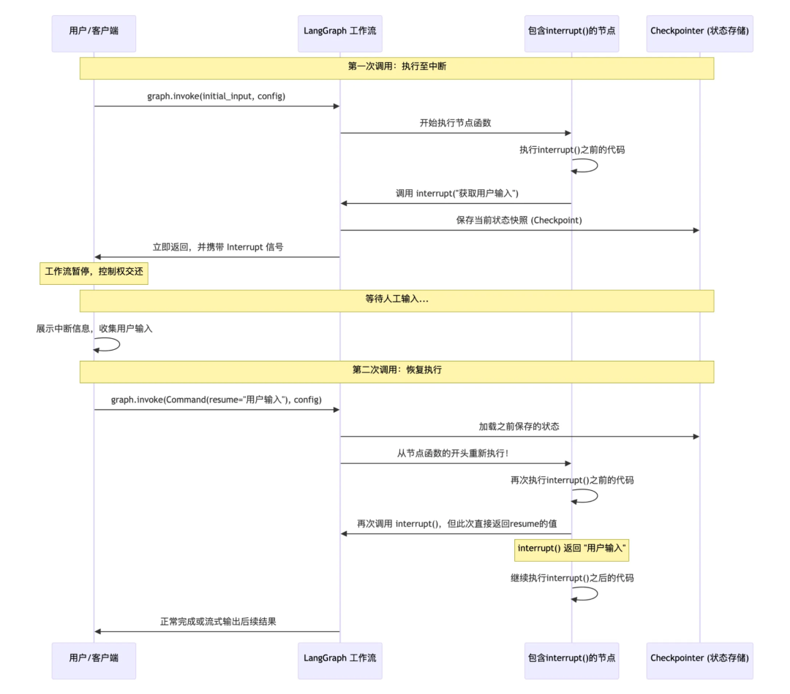
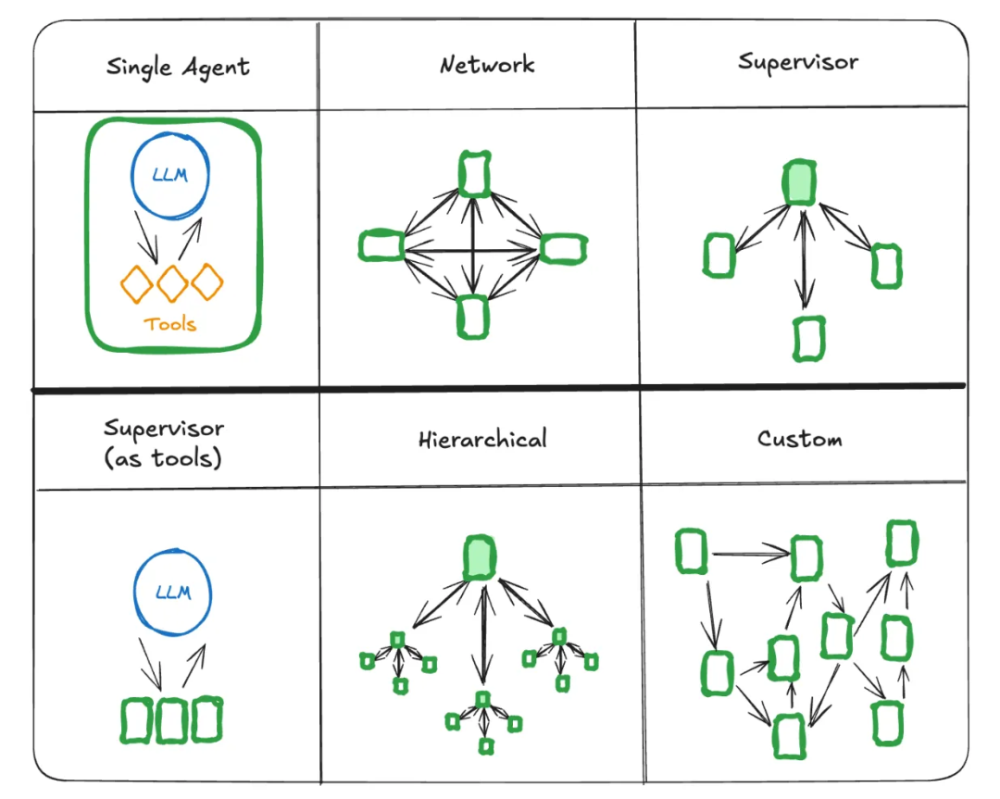
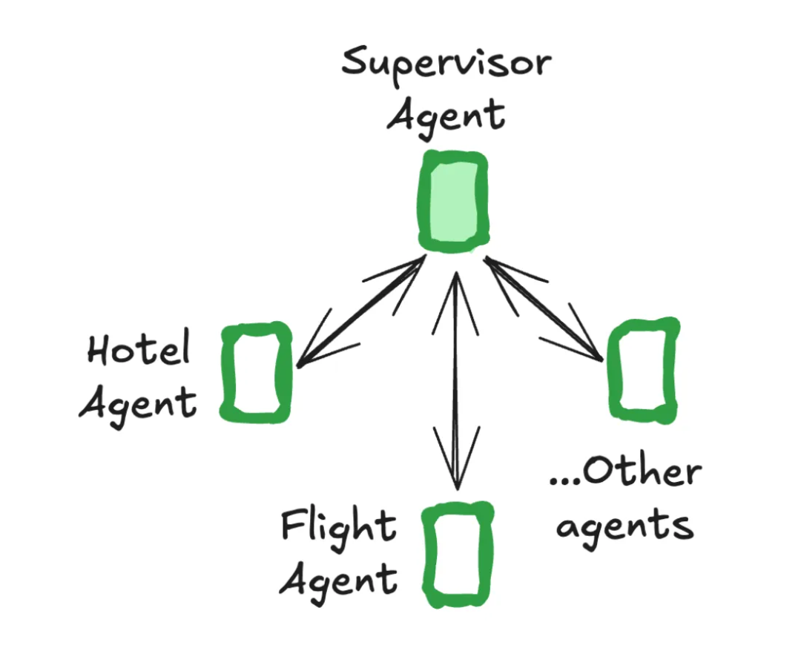
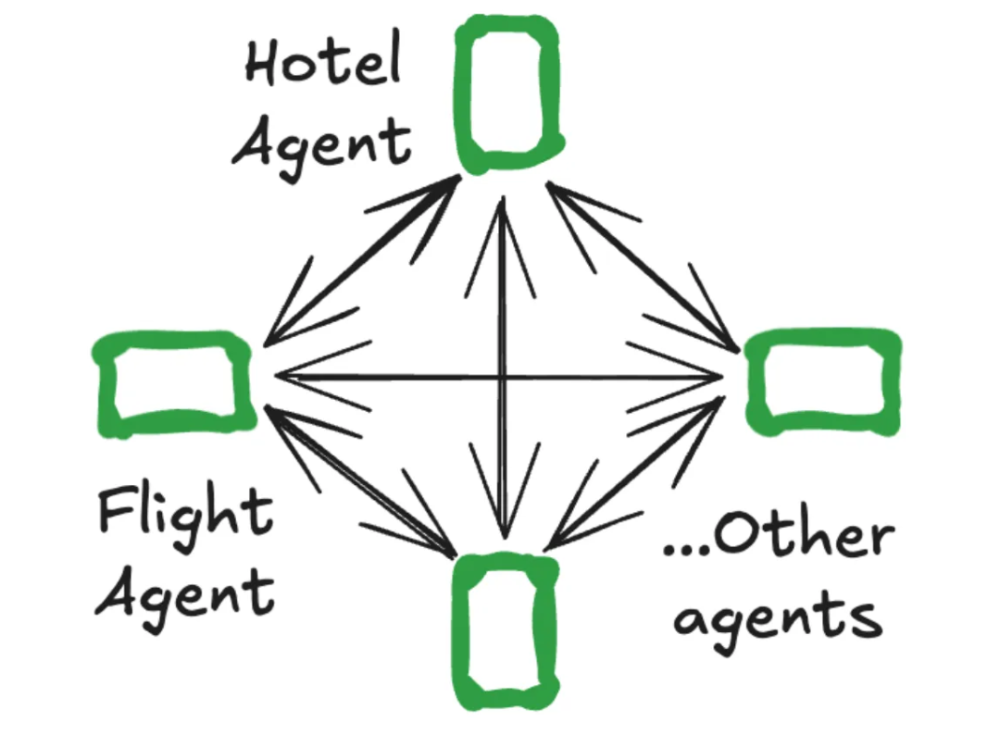
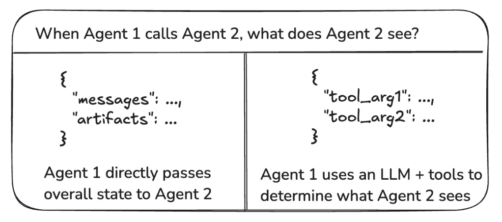

# Agent 与 RAG（二）：用 LangGraph 理解多智能体协作

上一篇从提示词工程开始，讨论怎样交代任务、提供上下文，以及检查模型的输出。接着会遇到另一个问题：一个任务需要经过检索、生成、校验，甚至人工审核时，这些步骤该怎样组织？

LangGraph 可以用来处理这层工作。它把执行过程组织成有状态的图，规定每一步做什么、更新哪些数据，以及接下来去哪里。理解这一层之后，再看多智能体的分工和协作，会更容易看清其中的控制关系。

本文根据贾岱发表于「腾讯云开发者」的[《Multi-Agent 全面爆发！一文详解多智能体核心架构及 LangGraph 框架》](https://mp.weixin.qq.com/s/XhFbLTLcSjDj0r3KGT9EOg)整理。原文发布于 2025 年 12 月 16 日；本文保留部分原文配图，调整了内容顺序，并结合当前官方资料修正版本差异。下面的三个 Python 例子用于观察框架行为，使用本地固定数据，不需要模型服务或 API Key。

## 先分清：工作流、Agent 和多智能体

假设要做一个知识库问答系统，最初的流程可能很清楚：收到问题，检索资料，再根据资料组织回答。每一步和它们之间的顺序都可以由程序确定，这是一条工作流。

如果执行过程中需要由模型判断“继续检索、调用某个工具，还是结束回答”，模型就参与了行动选择。Agent 的重点在于这个根据状态和反馈继续行动的过程。

当一个 Agent 面对太多工具、领域知识或历史上下文时，可以进一步拆分职责：让检索助手找资料，让核对助手检查引用，再由主助手整合结果。这才引出了多智能体协作。不过，是否拆分仍要看单个 Agent 的实际瓶颈，以及拆分后的成本和效果。[工作流与 Agent 的区别](https://docs.langchain.com/oss/python/langgraph/workflows-agents)

LangGraph 提供的是底层编排能力。图里的节点既可以是一个 Agent，也可以只是普通函数、数据库查询或模型调用；使用它不要求先构建一组智能体，也不要求把每一步都交给模型。[LangGraph 概述](https://docs.langchain.com/oss/python/langgraph/overview)

## 状态图里，数据和执行顺序怎样连接

[](images/langgraph-multi-agent/state-graph.png)

*图 1：用节点和边表达执行路径。原文配图，点击可查看原图。*

先记住四个概念：

| 概念 | 负责什么 | 放到知识库问答里 |
| --- | --- | --- |
| State | 保存当前数据快照 | 用户问题、检索结果、回答 |
| Node | 执行一个步骤并返回更新 | 检索资料、生成回答、检查引用 |
| Edge | 决定接下来执行哪个节点 | 检索后进入回答，或转到证据不足分支 |
| Reducer | 决定某个字段如何接收更新 | 覆盖一个结果，或累计多个分支的结果 |

State 可以理解为任务在各个阶段传递的工作单。节点接收当前状态，完成自己的步骤，再返回需要更新的字段。**节点可以只返回部分字段；没有返回的字段会保留。**

默认更新也是按字段发生的。例如，状态原本有 `question` 和 `documents`，节点返回 `{"documents": [...]}`，更新的是 `documents`，不会让 `question` 消失。一个字典字段被新字典替换时，也不能默认认为它内部的键会自动合并。[State 与 Reducer](https://docs.langchain.com/oss/python/langgraph/graph-api#reducers)

### 跑一条有分支的最小流程

下面用固定资料代替真实检索器，用字符串拼接代替模型生成，先观察状态传递和条件路由。三个例子都只依赖 `langgraph`，需要 Python 3.10 或更高版本；本次验证环境使用 Python 3.12.14、LangGraph 1.2.16。

```powershell
python -m pip install "langgraph==1.2.16"
```

将下面代码保存为 `query_graph.py`，在安装依赖的同一个 Python 环境中运行：

```python
from typing import Literal, TypedDict
from langgraph.graph import END, START, StateGraph


class QueryState(TypedDict):
    question: str
    documents: list[str]
    answer: str


def retrieve(state: QueryState) -> dict:
    documents = (
        ["State 是节点之间传递的数据快照。"]
        if "LangGraph" in state["question"]
        else []
    )
    return {"documents": documents}


def choose_next(
    state: QueryState,
) -> Literal["write_answer", "no_evidence"]:
    return "write_answer" if state["documents"] else "no_evidence"


def write_answer(state: QueryState) -> dict:
    return {"answer": "根据示例资料：" + "；".join(state["documents"])}


def no_evidence(state: QueryState) -> dict:
    return {"answer": "示例资料未覆盖这个问题。"}


builder = StateGraph(QueryState)
builder.add_node("retrieve", retrieve)
builder.add_node("write_answer", write_answer)
builder.add_node("no_evidence", no_evidence)
builder.add_edge(START, "retrieve")
builder.add_conditional_edges("retrieve", choose_next)
builder.add_edge("write_answer", END)
builder.add_edge("no_evidence", END)
app = builder.compile()

result = app.invoke({"question": "LangGraph 的 State 是什么？"})
print(result["question"])
print(result["answer"])

missing = app.invoke({"question": "怎样配置 Redis 集群？"})
print(missing["answer"])
```

运行后可以看到，输入的 `question` 在检索节点更新 `documents` 后依然保留；有资料时进入 `write_answer`，没有资料时进入 `no_evidence`。

这里验证的是一条确定性的工作流。接入真正的知识库问答时，需要替换检索和生成节点，并另外检查检索质量、引用依据和模型回答。检索服务发生网络错误，也应当与“成功检索但没有相关资料”区分开来。

`compile()` 会检查部分图结构问题，并生成可执行的图；它不能代替业务逻辑验证，也不能判断模型回答是否正确。

## 并发分工之前，先想清楚结果怎样合并

顺序执行时，默认的字段覆盖很容易理解。但如果两个分支在同一个执行步骤中都写入 `results`，谁的结果应该保留？

对于需要收集所有结果的字段，应明确指定合并方式。比如 `Annotated[list[str], add]` 表示用列表相加来合并更新。没有相应 Reducer 时，多个并发分支写同一个普通字段会发生更新冲突，不能把它当作“最后一个写入的值自然获胜”。[并发更新冲突说明](https://docs.langchain.com/oss/python/langgraph/errors/INVALID_CONCURRENT_GRAPH_UPDATE)

任务数量如果要在运行时决定，可以使用 `Send` 为每项任务创建分支，并给各个分支传入不同的数据。

[](images/langgraph-multi-agent/send-map-reduce.png)

*图 2：Send 与 Map-Reduce。图中画了多个节点，实际也可以把多份任务发送给同一个 worker 节点。原文配图。*

下面是一个独立可运行的分发与汇总例子，worker 用字符串结果模拟任务完成：

```python
from operator import add
from typing import Annotated, TypedDict
from langgraph.graph import END, START, StateGraph
from langgraph.types import Send


class BatchState(TypedDict):
    tasks: list[str]
    results: Annotated[list[str], add]


def dispatch(state: BatchState):
    return [Send("worker", {"task": task}) for task in state["tasks"]]


def worker(state: dict) -> dict:
    return {"results": [f"完成：{state['task']}"]}


builder = StateGraph(BatchState)
builder.add_node("worker", worker)
builder.add_conditional_edges(START, dispatch, ["worker"])
builder.add_edge("worker", END)
app = builder.compile()

result = app.invoke({
    "tasks": ["检索资料", "核对引用"],
    "results": [],
})
print(sorted(result["results"]))
```

每个 worker 只返回自己新增的一项结果，由 Reducer 完成累计。这里排序后打印，是为了便于查看，不能用结果列表的位置推断任务实际完成的先后。真实任务能获得多少并发收益，还取决于依赖关系、执行资源和外部接口限制。[Send 示例](https://docs.langchain.com/oss/python/langgraph/use-graph-api#map-reduce-and-the-send-api)

消息列表还要单独考虑。`operator.add` 只是列表拼接；专门用于消息的 `add_messages` 会按消息 ID 合并，新 ID 追加，相同 ID 更新。使用追加型 Reducer 时，节点通常返回本次新增的内容，反复返回完整历史可能造成重复。[消息状态与 add_messages](https://docs.langchain.com/oss/python/langgraph/graph-api#working-with-messages-in-graph-state)

## 动态路由和控制权交接，是两个相连的问题

LangGraph 中有几种容易混在一起的控制方式：

| 机制 | 主要用途 |
| --- | --- |
| 普通边 | 执行固定的下一步 |
| 条件边 | 根据当前状态选择一个或多个后续节点 |
| Send | 动态创建带有各自输入的任务分支 |
| Command | 在节点返回值里同时表达状态更新和下一步去向；也用于恢复中断 |

例如，一个专家 Agent 判断需要另一个专家接手时，可以返回带有 `update` 和 `goto` 的 `Command`。交接需要说清楚两件事：接下来由谁处理，以及要带过去哪些任务信息。

这里有一个容易遗漏的行为：**Command 增加动态路由，不会自动取消已经配置的普通出边。** 同一个节点如果既返回动态去向，又连着固定出边，两条路径都可能执行。设计时应明确采用哪一种路由方式。[Command 与静态边](https://docs.langchain.com/oss/python/langgraph/graph-api#command)

有循环时还需要明确退出条件。`recursion_limit` 限制的是图的一次执行最多经过多少个 super-step，不是 Python 函数递归深度，也不等于模型调用总次数；并行执行的节点可能处于同一个 super-step。这个参数放在调用配置顶层，例如 `app.invoke(inputs, {"recursion_limit": 20})`。不应沿用旧教程里的默认步数来推断当前版本行为。[执行步数限制](https://docs.langchain.com/oss/python/langgraph/graph-api#recursion-limit)

## 运行到一半，怎样保存、暂停和继续

执行顺序清楚之后，接下来要考虑任务能否跨调用继续。

| 机制 | 主要保存什么 | 典型范围 |
| --- | --- | --- |
| State | 本次图执行中使用的数据 | 当前任务的工作状态 |
| Checkpointer | 图状态和继续执行所需的检查点信息 | 用 thread_id 区分的执行线程 |
| Store | 应用主动读写的资料，如用户偏好 | 可以跨不同执行线程使用 |

这里的“线程”是由 `thread_id` 标识的业务执行上下文，不是操作系统线程。短期记忆与长期记忆的区别，主要在于作用范围和访问方式，也不能简单按“放内存还是放磁盘”划分。[持久化与记忆](https://docs.langchain.com/oss/python/langgraph/persistence)

`InMemorySaver` 把检查点放在进程内存里，方便演示同一进程中的连续调用。要在程序退出或重启后恢复，需要使用 SQLite、PostgreSQL 等持久化检查点实现。把内存检查点传给 `compile()`，并不会自动获得落盘能力。

检查点通常在图的 super-step 边界建立，不是任意一行 Python 代码的完整快照。时间旅行可以用来查看历史状态、从历史状态继续或探索另一条路径；它不能自动撤销已经发生的外部业务操作。修改历史状态时，也要遵守对应字段的 Reducer 规则。

### 把人工审核放进执行过程

人工审核可以通过 `interrupt()` 暂停图，让调用方展示待审内容，再用相同的 `thread_id` 和 `Command(resume=...)` 传回意见。

[](images/langgraph-multi-agent/interrupt-resume.png)

*图 3：恢复时会从包含 interrupt 的节点开头重新执行。原文配图，点击可查看时序细节。*

下面的独立例子只记录审核意见：

```python
from typing import TypedDict
from langgraph.checkpoint.memory import InMemorySaver
from langgraph.graph import END, START, StateGraph
from langgraph.types import Command, interrupt


class ReviewState(TypedDict):
    draft: str
    approved: bool


def review(state: ReviewState) -> dict:
    approved = interrupt({"draft": state["draft"], "question": "是否通过审核？"})
    return {"approved": approved}


builder = StateGraph(ReviewState)
builder.add_node("review", review)
builder.add_edge(START, "review")
builder.add_edge("review", END)
app = builder.compile(checkpointer=InMemorySaver())
config = {"configurable": {"thread_id": "article-review-demo"}}

paused = app.invoke({"draft": "这是一段待审核的回答。"}, config)
print(paused["__interrupt__"][0].value["draft"])

resumed = app.invoke(Command(resume=True), config)
print(resumed["approved"])
```

第一次调用会返回中断信息；审核节点后面的逻辑尚未执行。示例最后用 `True` 模拟一次审核输入，实际应用应在取得用户的意见后再恢复。

恢复时，包含 `interrupt()` 的节点会从开头重新运行，执行到中断位置后取得传回的值。因此，放在中断前的数据库写入、创建工单等操作可能重复发生。需要避免重复业务效果时，应使用业务唯一标识、去重约束或合适的事务设计。**幂等性关注重复执行是否产生额外效果，不等于“相同输入总是产生相同输出”。** [中断与恢复规则](https://docs.langchain.com/oss/python/langgraph/interrupts)

## 多智能体架构，重点看谁掌握控制权

有了状态、路由和恢复机制，多智能体就可以放回具体的执行图中理解。

[](images/langgraph-multi-agent/multi-agent-patterns.png)

*图 4：原文按通信拓扑整理的架构形态。这些形态可以组合使用。原文配图。*

### Supervisor：由主管组织分工和汇总

Supervisor 接收总体任务，判断需要调用哪些专业助手，并整合它们的结果。比如，主管根据一次出行需求分别调用航班助手和酒店助手，再向用户汇总。

[](images/langgraph-multi-agent/supervisor.png)

*图 5：集中协调的主管模式。原文配图。*

一种常见实现是把子 Agent 暴露为工具。主管提供明确的任务参数，子 Agent 完成自己的子任务并返回结果，后续安排仍由主管决定。上下文和输出接口因此可以分别设计。[子 Agent 作为工具](https://docs.langchain.com/oss/python/langchain/multi-agent/subagents)

这种模式适合有明确分工、需要统一汇总的任务。需要同时考虑主管的决策是否准确、子任务结果是否足够，以及多次往返带来的额外模型调用和延迟。集中调度本身不保证任务一定正确完成。

### Handoffs 与 Swarm：把当前任务交给合适的专家

Handoff 的重点是控制权发生转移：当前助手判断另一个助手更适合处理后续任务，于是带着相关信息交给它。

[](images/langgraph-multi-agent/swarm-handoffs.png)

*图 6：原文中 Swarm 的协作示意。箭头代表允许的交接关系。原文配图。*

例如，航班助手确认了用户的行程条件后，把酒店需求交给酒店助手；酒店助手可以围绕住宿问题继续与用户交互。设计时需要明确哪些交接是允许的、交过去的任务是什么，以及谁负责结束整个流程。[Handoffs](https://docs.langchain.com/oss/python/langchain/multi-agent/handoffs)

这里的 Swarm 指原文介绍的协作模式。Network 描述的是智能体之间可以怎样连接，不能仅凭连成网络就推断系统具有某种可靠性或自主能力。

### 层级结构和自定义图，解决更具体的组织问题

层级结构可以让一个主管协调多个团队，每个团队内部再分工。自定义图则可以把固定步骤、条件路由、并发任务和 Agent 混合起来。例如，先用固定程序检查资料，再让模型判断是否追加检索，最后进入人工审核。

| 结构 | 谁决定下一步 | 适合关注的问题 |
| --- | --- | --- |
| Supervisor／子 Agent 工具 | 主管统一调度 | 分工清楚，结果需要统一整合 |
| Handoffs／Swarm | 当前 Agent 决定是否交接 | 当前专家需要把对话或后续任务转给其他专家 |
| Hierarchical | 多层主管分别管理职责 | 已有清楚的团队或领域层次 |
| Custom workflow | 按图中的固定逻辑或动态判断执行 | 流程约束、模型决策和人工步骤需要混合 |

这些是理解架构的不同视角，并不是必须逐级升级的路线。更细的拆分还会带来更多接口、上下文传递和调试成本。

## 协作质量，很大一部分取决于交过去什么信息

只画出智能体之间的箭头，还没有完成协作设计。接下来要问：下一个 Agent 实际能看到什么？

[](images/langgraph-multi-agent/agent-context.png)

*图 7：共享状态与受控工具参数，是两种不同的信息传递方式。原文配图。*

对知识库问答来说，交给核对助手的内容可以是：当前问题、候选回答、相关证据和引用位置。它未必需要看到检索助手用过的所有工具、全部聊天历史和每一次失败尝试。

也可以给每个专业助手保留自己的内部工作状态，只把任务结果和必要依据交回主流程。需要共享完整可见历史时，应考虑上下文长度、重复信息和职责混淆；需要摘要时，也要检查是否丢掉了关键限制。

原文提到的“完整推理数据”在这里应当谨慎理解。可传递的内容包括应用能获得的消息、工具调用结果和说明，不能假定已经获得模型完整的内部推理过程。设计接口时，更有用的是明确任务、证据、结果和未解决的问题。[多智能体的上下文设计](https://docs.langchain.com/oss/python/langchain/multi-agent)

## 其他能力，按实际问题接入

原文还介绍了子图、MCP、缓存和重试。这些能力有用，但不需要为了使用 LangGraph 一次引入全部组件：

- **子图**：把一段独立流程封装为节点。父图与子图有兼容的共享状态字段时，可以直接连接；状态结构不同时，用节点显式转换输入与输出。
- **运行时上下文**：传入模型选择、客户端或数据库连接等依赖，与需要被检查点保存的业务状态区分开。
- **MCP**：连接外部工具和资源的协议。它帮助统一工具接入，与“怎样协调多个 Agent”处于不同层次。
- **重试和缓存**：针对明确的问题配置。网络暂时失败可以考虑重试，带写入效果的操作需要考虑重复执行；缓存要结合数据时效和存储介质判断有效期。

读原教程时，还要留意版本入口。LangGraph v1 已将 `create_react_agent` 标为弃用，新的高层 Agent 入口是 `langchain.agents.create_agent`。直接使用本文的 `StateGraph` 小例子，不需要先创建模型 Agent。[v1 迁移说明](https://docs.langchain.com/oss/python/migrate/langgraph-v1)

原文的 `langgraph-supervisor` 长教程也适合改为架构参考。截至本次核对的 2026 年 10 月 20 日，该仓库已归档，其 README 推荐多数场景直接用工具调用组织主管模式；具体项目应结合当前官方示例选择实现方式。[Supervisor 仓库说明](https://github.com/langchain-ai/langgraph-supervisor-py)

## 回到一个具体选择：什么时候值得拆成多个 Agent

如果目标只是“检索资料并回答”，可以先做一条简单工作流，检查检索是否相关、答案是否有依据。需要时，再增加模型选择工具或追加检索的循环。

如果问题在于不同领域需要不同工具和很长的专业上下文，再考虑按职责拆分。子任务相互独立时，可以评估并发处理；需要专家直接接手对话时，可以评估 handoff；流程必须经过审核时，把审核设置为真正的执行节点。

选择之后，应当用同一组任务比较：成功率和证据质量有没有改善，模型调用、Token 用量和延迟增加了多少，失败时能否定位到具体步骤。这样，复杂度的增加才有可以检查的理由。

对这一篇而言，最值得先掌握的是：状态按什么规则更新，下一步由谁决定，交接时带走哪些信息，以及运行中断后怎样继续。把这几件事放在一起，LangGraph 的基础能力与多智能体的协作方式就连起来了。

[上一篇：从提示词工程开始](http://8.134.172.39/blog/agent-rag-01-prompt-engineering)
